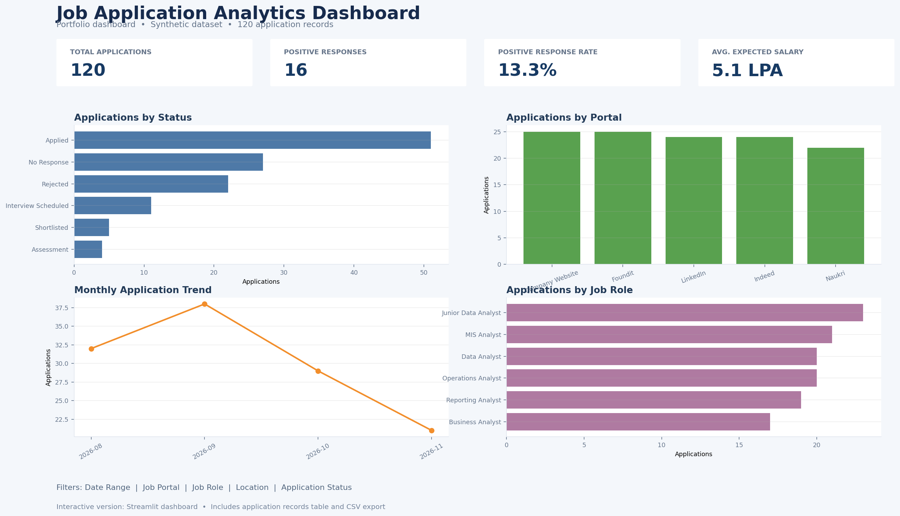

# Job Application Analysis — SQL & Dashboard

A data analytics portfolio project analyzing **120 synthetic job application records** using MySQL and an interactive Streamlit dashboard.

## What I Did
- Created a sample dataset of 120 fictional job application records.
- Analyzed application status, portals, roles, companies, locations, monthly trends, response rate, and expected salary using SQL.
- Used SQL aggregations, CASE statements, date functions, HAVING, CTEs, and window functions.
- Built an interactive dashboard with KPI cards, filters, charts, a records table, and CSV export.

## Dashboard Preview



## Dashboard Features
- **KPIs:** Total Applications, Positive Responses, Positive Response Rate, Average Expected Salary
- **Filters:** Date Range, Job Portal, Job Role, Location, Application Status
- **Charts:** Status Distribution, Applications by Portal, Monthly Trend, Applications by Role
- **Records:** Browse application data and export filtered records to CSV

## Technologies Used
SQL, MySQL, Python, Pandas, Streamlit, Plotly

## Dataset
`data/job_applications_sample.csv` contains 120 fictional records with company, job role, location, application date, portal, status, experience level, and expected salary.

## Run Dashboard
```bash
python -m pip install -r requirements.txt
python -m streamlit run app.py
```

## SQL Setup
Run `sql/01_create_database_table.sql` in MySQL Workbench, import the sample CSV into the table, then run `sql/02_analysis_queries.sql`.

## SQL Concepts Demonstrated
SELECT, WHERE, GROUP BY, ORDER BY, aggregate functions, CASE, HAVING, date functions, CTEs, and RANK().

## Resume Description
**Job Application Analysis | SQL, MySQL, Python, Pandas, Streamlit**
- Analyzed 120 synthetic job application records to track application status, job roles, companies, locations, portals, and monthly trends.
- Used SQL aggregations, CASE statements, date functions, HAVING, CTEs, and window functions to analyze application patterns and response rates.
- Developed an interactive Streamlit dashboard featuring KPI metrics, filters, visualizations, data tables, and CSV export.

*This project uses synthetic data for portfolio and learning purposes. Do not upload personal job tracker records publicly.*
