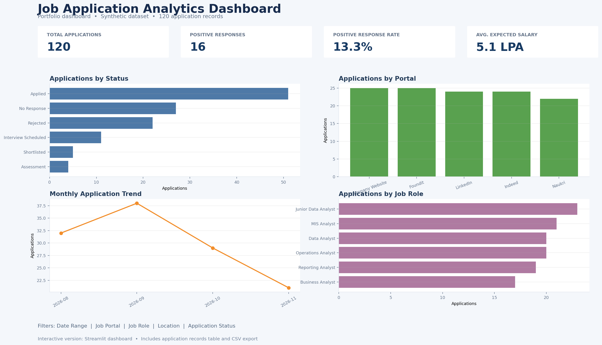

# Job Application Analysis — SQL & Dashboard

A data analytics project to analyze job application data and understand application progress, response rates, and trends.

## Dashboard Preview



## What I Did

1. Created a sample dataset containing 120 job application records.
2. Organized job application information such as company, job role, location, portal, application date, status, and expected salary.
3. Imported the dataset into MySQL.
4. Wrote SQL queries to analyze application data.
5. Analyzed application status, job portals, job roles, locations, and monthly trends.
6. Calculated positive response rate and average expected salary.
7. Used SQL concepts such as `GROUP BY`, aggregate functions, `CASE`, `HAVING`, CTEs, and window functions.
8. Created an interactive dashboard using Python, Pandas, and Streamlit.
9. Added KPI cards, filters, charts, a data table, and CSV export functionality.

## Dashboard Features

- Total Applications
- Positive Responses
- Positive Response Rate
- Average Expected Salary
- Filters for date, job portal, job role, location, and status
- Application status analysis
- Job portal analysis
- Monthly application trends
- Job role analysis
- Application records table
- CSV export

## Tools & Technologies

- SQL
- MySQL
- Python
- Pandas
- Streamlit
- Plotly

## Dataset

The project uses 120 synthetic job application records created for learning and portfolio purposes.

## Project Structure

```text
Job-Application-Analysis/
├── data/
│   └── job_applications_sample.csv
├── sql/
│   ├── 01_create_database_table.sql
│   └── 02_analysis_queries.sql
├── app.py
├── dashboard.png
├── requirements.txt
└── README.md
